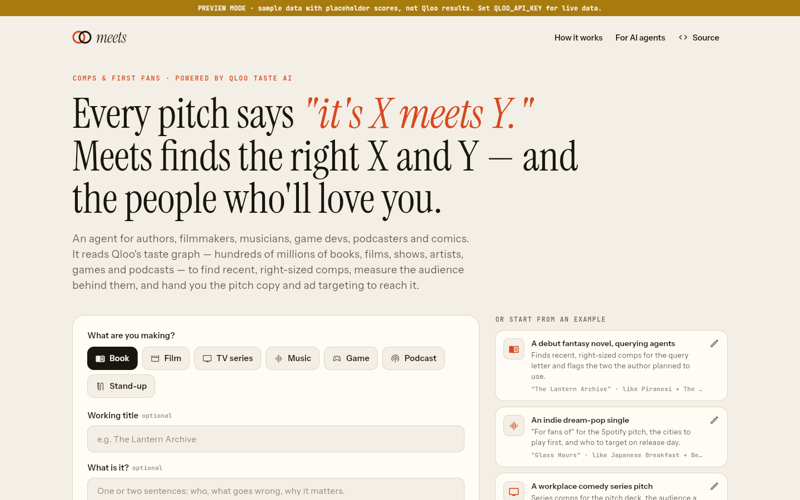
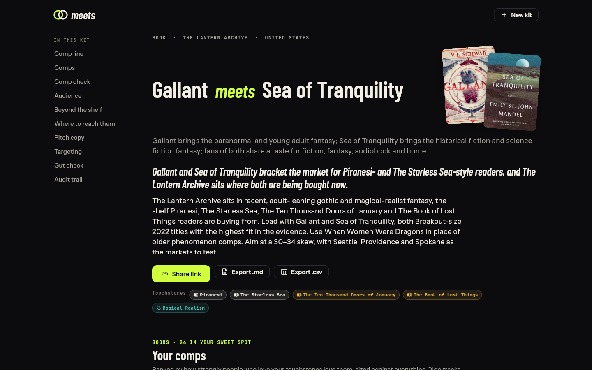
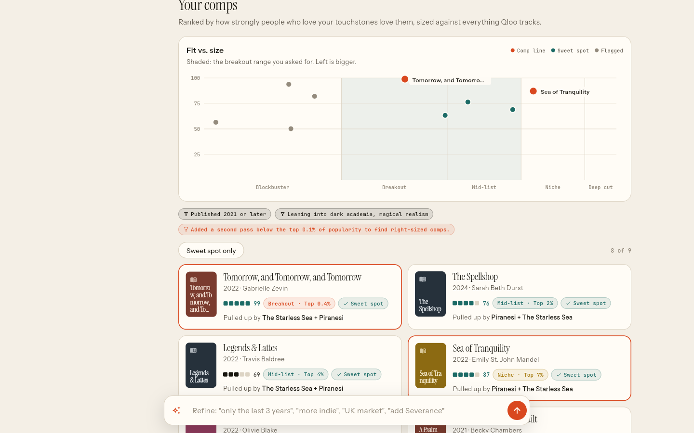
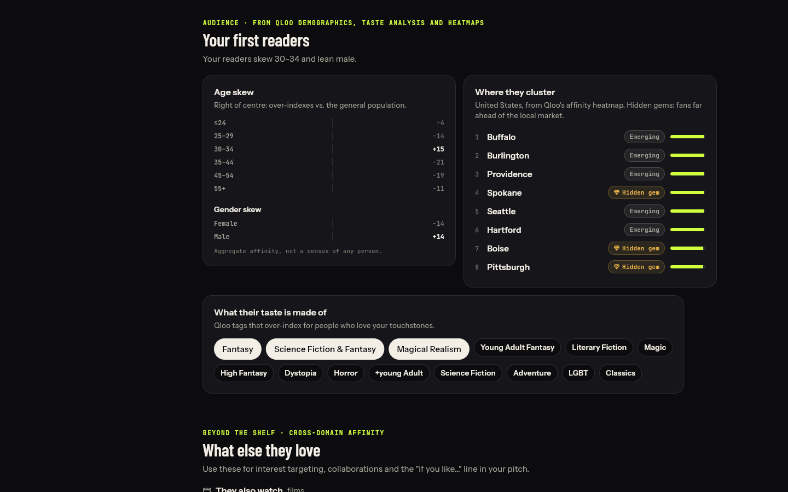
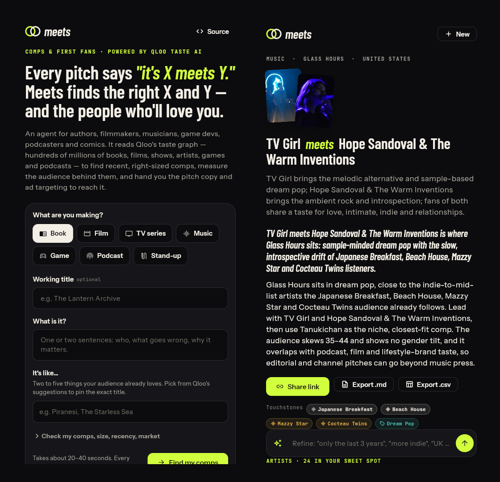

# Meets — comps & first fans for anything you make

> Every pitch says *"it's X meets Y."* **Meets** finds the right X and Y — and the people who'll love you.

Meets is an AI agent for authors, filmmakers, showrunners, musicians, game developers, podcasters and comedians. Describe what you're making and what it's like. Meets then reads **Qloo's taste graph** to:

1. **Find comps that help.** It looks for recent, right-sized comparable titles, not the blockbusters every buyer is tired of hearing.
2. **Pick the comp line.** It tests pairings to find the two comps that triangulate your work ("A meets B").
3. **Check the comps you planned to use.** It flags the ones that are too big, too old or a weak audience fit, and suggests swaps.
4. **Measure your first fans.** It reports their age and gender skew, the tags that define their taste, the cities where they cluster (including hidden gems), and what else they read, watch, play and listen to.
5. **Hand you the kit.** You get a query-letter or pitch-deck paragraph, a "for fans of" line, ad hooks, and ready-to-paste targeting lists for Amazon, BookBub, Meta, Spotify, Steam and podcast ads.

Built for the [Qloo Agentic Hackathon](https://qloo.devpost.com/) ("Agents, but with taste").

**Live demo:** _add your deployed URL here_ · **MCP endpoint:** `<your-url>/mcp`







<sub>Screenshots use preview mode (labelled sample data with placeholder scores). Live kits use real Qloo data.</sub>

---

## Why this needs Qloo (and not just an LLM)

| A chatbot alone… | Meets with Qloo |
|---|---|
| names the obvious phenomenon ("Harry Potter meets The Hunger Games") | reads Qloo **popularity percentiles** and digs below the top 0.1% (`filter.popularity.max`) for comps your size |
| stops at its training cutoff | filters by **release, publication or air year** (`filter.publication_year.min`, `filter.release_year.min`, `filter.latest_known_year.min`) |
| guesses who the audience is | measures **affinity** across books, film, TV, music, games, podcasts, people and brands, plus **demographics** (`urn:demographics`), **taste tags** (`urn:tag`) and **where fans cluster** (`urn:heatmap`) |
| can invent titles | can only cite entities Qloo returned: the writer model refers to them by `{{alias}}` and the server swaps in real names |

The kit includes a **Gut check** section. It asks the same model for comps *without* Qloo, then looks up each suggestion and scores it against the same audience. Its verdicts are "holds up", "too big", "too old", "weak fit" or "not in Qloo".

## How the agent works

```
brief ──► read (LLM proposes touchstones/themes; only Qloo-verified ones are kept)
      ──► resolve      GET /search · /entities · /v2/tags
      ──► scan         GET /v2/insights  filter.type=<book|movie|tv_show|artist|videogame|podcast|person>
                         signal.interests.entities · signal.interests.tags · signal.demographics.age
                         filter.<year>.min · filter.exclude.entities · feature.explainability
          └─ adapts:   too few results → drop themes, widen the window
                       head is all blockbusters → second pass with filter.popularity.max
      ──► context      cross-domain + channel scans (podcasts, brands) in parallel
      ──► audience     urn:demographics · urn:tag (filter.parents.types) · urn:heatmap → cities
      ──► pair         filter.results.entities as a pairwise similarity oracle · /v2/analysis/compare
      ──► comp check   /search + filter.results.entities → keep / swap verdicts
      ──► write        Claude writes copy from an evidence digest, may call check_fit / compare_audiences,
                       every {{alias}} validated against the ledger; templates if no LLM
      ──► refine       "only the last 3 years", "more indie", "UK market", "add Severance" → update_brief → re-run
```

Every stage, decision and Qloo call streams to the UI. The full trail ships with the kit (see "Audit trail").

## Repository layout

| Path | What |
|---|---|
| `packages/meets_core/` | Pure-Dart models and scoring shared by server and app: size bands from popularity percentiles, recency, fit, pairing, market aggregation, format configs |
| `server/` | Dart (shelf) API: Qloo client (throttle, cache, retries, param validation), agent, Anthropic client (raw HTTP), run manager, MCP endpoint, exports, image proxy |
| `server/bin/probe.dart` | Live contract check of every Qloo call shape Meets uses |
| `server/bin/bake.dart` | Pre-builds the example kits with live data so visitors get instant results |
| `server/examples/` | Example briefs (and baked kits once you run `bake`) |
| `app/` | Flutter app: web first, also builds for Android and iOS |
| `Dockerfile`, `render.yaml`, `fly.toml` | One image serves the web app and the API |

## Run it locally

Requirements: Flutter 3.47+ (includes Dart 3.13).

```bash
# 1. Server (preview mode needs no keys: labelled sample data, never Qloo results)
cd server && dart pub get
QLOO_MODE=preview dart run bin/server.dart          # http://localhost:8080

# 2. App
cd ../app && flutter pub get
flutter run -d chrome --dart-define=API_BASE=http://localhost:8080
#   or build once and let the server host it:
flutter build web --release --no-web-resources-cdn   # server serves ../app/build/web
```

With real keys:

```bash
cp .env.example .env    # fill QLOO_API_KEY (+ ANTHROPIC_API_KEY)
set -a; source .env; set +a
cd server
dart run bin/probe.dart # verify every Qloo call against the hackathon host
dart run bin/bake.dart  # pre-build the 7 example kits
dart run bin/server.dart
```

## Deploy

One container serves everything:

```bash
docker build -t meets .
docker run -p 8080:8080 -e QLOO_API_KEY=... -e ANTHROPIC_API_KEY=... -e PUBLIC_URL=https://your.host meets
```

- **Render:** New → Blueprint → this repo (`render.yaml`). Set the secrets.
- **Fly.io:** see the header of `fly.toml`.
- **Google Cloud Run:** `gcloud run deploy meets --source . --allow-unauthenticated --max-instances=1 --set-env-vars QLOO_API_KEY=...,ANTHROPIC_API_KEY=...,TRUSTED_PROXY_HOPS=2`. One instance, so live runs and their polling share memory.

Mobile builds point at the deployed API: `flutter build apk --dart-define=API_BASE=https://your.host`.

## Configuration

See [`.env.example`](.env.example). Highlights:

| Variable | Default | Notes |
|---|---|---|
| `QLOO_API_KEY` | — | Hackathon keys only work on `https://hackathon.api.qloo.com` (sent as `X-Api-Key`) |
| `ANTHROPIC_API_KEY` | — | Optional. Enables logline reading, LLM copy, refine and gut check |
| `LLM_MODEL` | `claude-sonnet-5-5` | Effort via `LLM_EFFORT` (default `medium`); server-side refusal fallbacks enabled |
| `RUNS_PER_HOUR_PER_IP` / `RUNS_PER_DAY` | 20 / 400 | Protects the shared key (5 req/s, 10k/month). A full run is ~25–35 Qloo calls; repeats hit the cache |
| `QLOO_MODE` | `live` if key set | `preview` serves **labelled sample data** for UI work only |

## Use Meets from your own agent (MCP)

```json
{ "mcpServers": { "meets": { "type": "http", "url": "https://your.host/mcp" } } }
```

Tools: `find_comps(format, touchstones, logline?, market?, recency_years?, size?)` and `check_comps(..., comps)`. They return text plus structured content and a link to the full kit.

## Tests

```bash
cd packages/meets_core && dart test     # scoring, bands, pairing, markets, JSON
cd server && dart test                  # Qloo client, parsers vs documented shapes, agent, LLM grounding, API, MCP
cd app && flutter test                  # report widgets
```

CI runs all three on every push (`.github/workflows/ci.yml`).

## Honest limits

- Fit, size and markets are **aggregate taste affinities** from Qloo. They are not sales forecasts and say nothing about any individual. Meets sends Qloo only public titles and names, never personal data.
- "Top 1%" popularity is still well known: Qloo ranks against every entity of the type.
- Qloo has no release-year filter for artists, podcasts or people, so recency only applies to books, film, TV (and games when a year is present).
- Some entity fields (book authors, game years) aren't in the public docs. The parsers are defensive, and `bin/probe.dart` shows what the live API returns.

## Credits

Taste data: [Qloo](https://www.qloo.com/) Taste AI (hackathon tier). Writing model: Claude (Anthropic). Fonts: Barlow Condensed, Instrument Sans, JetBrains Mono (SIL OFL). Built with substantial help from Claude Code.

MIT licensed. See [LICENSE](LICENSE).
